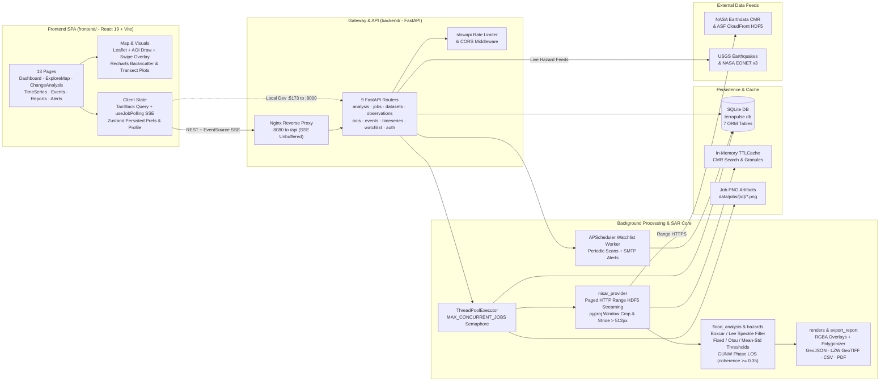
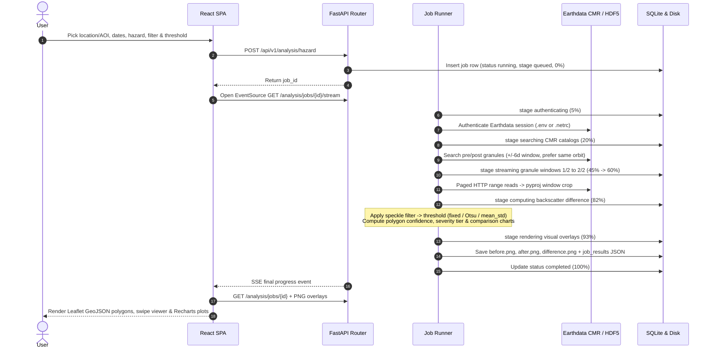
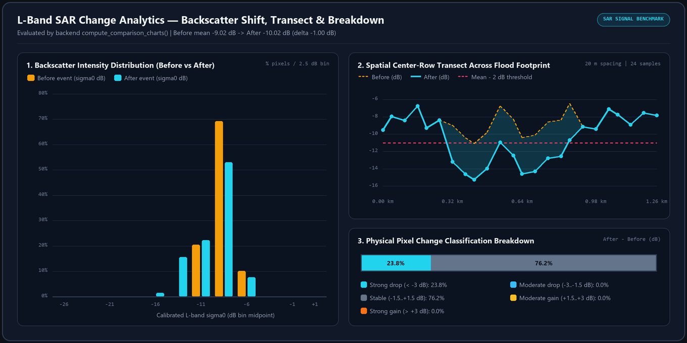
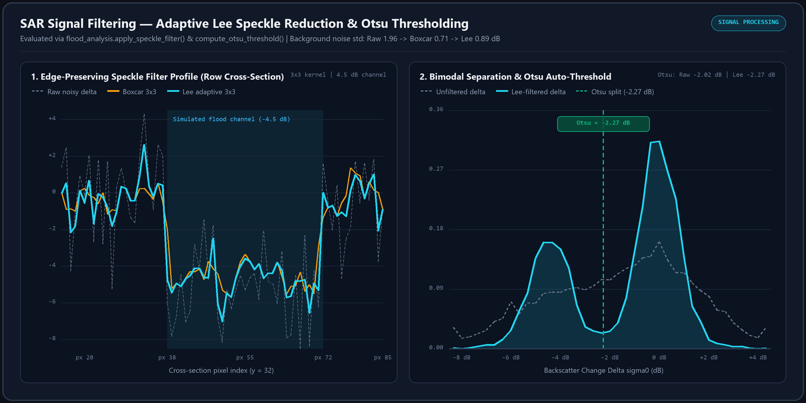
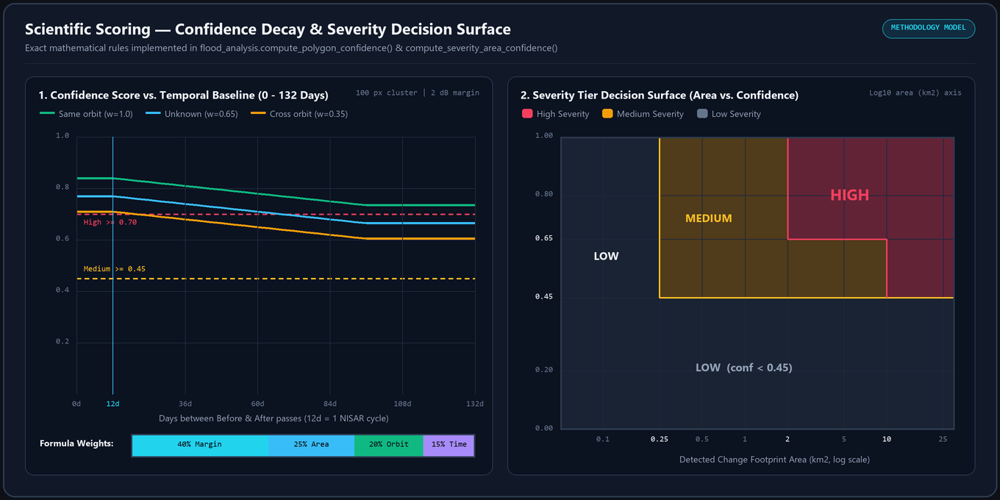
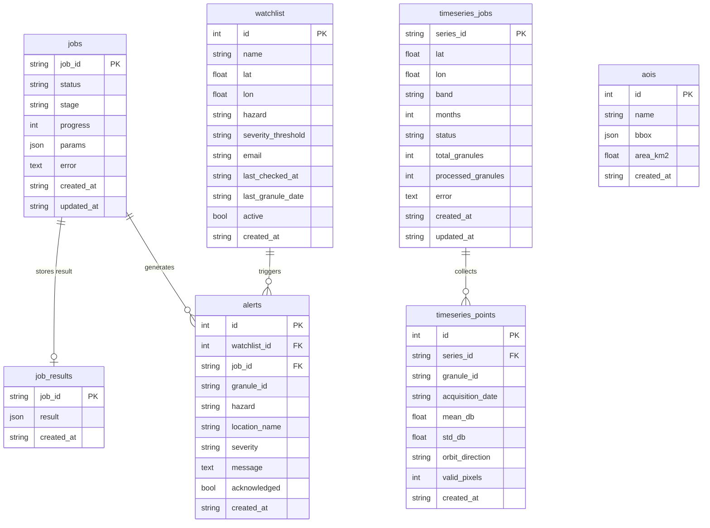

<div align="center">

# TerraPulse — Earth Surface Intelligence

**Observe Earth. Understand Change.**

*Full-stack geospatial intelligence platform for detecting and analyzing Earth-surface change from NASA–ISRO NISAR L-band SAR and InSAR products streamed directly from NASA Earthdata CMR.*


[Architecture](#system-architecture) · [Processing Pipeline](#live-analysis--sse-pipeline) · [SAR Graphs](#sar-signal--scientific-graphs) · [Hazard Modes](#supported-multi-hazard-modes) · [Database Schema](#database-persistence-schema) · [API](#key-api-endpoints-apiv1) · [Quick Start](#quick-start-local-development)

</div>

---

TerraPulse streams spatial subsets of **NASA–ISRO NISAR** `GCOV` (Geocoded Polarimetric Covariance) and `GUNW` (Geocoded Unwrapped Interferogram) granules over HTTP range requests, computes multi-hazard backscatter or LOS phase change, extracts georeferenced GeoJSON polygons and PNG overlays, and visualizes results across interactive maps, backscatter distributions, transects, and automated watchlists.

> [!IMPORTANT]
> Independent educational and engineering project — **not an official NASA or ISRO product**. Every result is an **indicator only** (never a validated hazard map) and preserves explicit scientific caveats and `"CANNOT conclude"` boundaries.

---

## System Architecture



---

## Live Analysis & SSE Pipeline

Each `POST /api/v1/analysis/hazard` call immediately returns a `job_id` while executing CMR search, remote HDF5 subsetting, signal processing, and visual rendering asynchronously with live milestone updates pushed over Server-Sent Events (`GET /api/v1/analysis/jobs/{id}/stream`).



---

## SAR Signal & Scientific Graphs

All three figures below are computed directly using TerraPulse's backend math functions ([`compute_comparison_charts`](backend/app/services/job_runner.py), [`apply_speckle_filter`](backend/app/services/flood_analysis.py), [`compute_otsu_threshold`](backend/app/services/flood_analysis.py), [`compute_polygon_confidence`](backend/app/services/flood_analysis.py), and [`compute_severity_area_confidence`](backend/app/services/flood_analysis.py)).

### 1. L-Band Backscatter Distribution, Spatial Transect & Condition Breakdown

Mirrors TerraPulse's interactive `ChangeCharts` view on a simulated `-9.0 dB` baseline scene with a `-4.2 dB` flood inundation zone (`20 m` grid spacing, `24`-sample horizontal transect, and 5-class change breakdown):



### 2. Adaptive Lee Speckle Reduction & Bimodal Otsu Separation

Demonstrates how TerraPulse's `3×3` adaptive **Lee** filter suppresses multiplicative radar speckle noise (`std: 1.96 dB → 0.89 dB`) while preserving sharp inundation boundaries better than uniform boxcar smoothing, carving a clean bimodal valley for automatic [`compute_otsu_threshold`](backend/app/services/flood_analysis.py) detection (`-2.27 dB`):



### 3. Confidence Score Decay & 2D Severity Tier Decision Surface

Visualizes how TerraPulse scores every detected polygon (`0.05–0.98`) using signal margin (`40%`), log-scaled cluster area (`25%`), orbit alignment (`20%`), and valid pixel fraction decayed across temporal separation (`15%`), alongside the 2D `Area (km²) × Confidence` decision regions for **High**, **Medium**, and **Low** alerts:



---

## Supported Multi-Hazard Modes

Defined in [`backend/app/services/hazards.py`](backend/app/services/hazards.py) with collection short-name resolution across `PROVISIONAL`, `V1`, and `BETA` NISAR products:

| Hazard Preset | Label | Signal Mode | Default Band / Product | Default Trigger |
|---|---|---|---|---|
| `flood` | Flood / wetland change | `decrease` | `HH` (`nisar_l2_gcov`) | `Δσ⁰ <= -2.0 dB` |
| `tsunami` | Tsunami coastal impact | `decrease` | `HH` (`nisar_l2_gcov`) | `Δσ⁰ <= -2.0 dB` |
| `hurricane` | Hurricane / storm damage | `both` | `HH` (`nisar_l2_gcov`) | `Δσ⁰ <= -2.0 dB` or `abs(Δσ⁰) >= 2.0 dB` |
| `volcano` | Volcanic eruption disturbance | `magnitude` | `HH` (`nisar_l2_gcov`) | `abs(Δσ⁰) >= 2.0 dB` |
| `earthquake` | Earthquake surface disturbance | `magnitude` | `HH` (`nisar_l2_gcov`) | `abs(Δσ⁰) >= 2.0 dB` |
| `forest_disturbance` | Forest disturbance / canopy loss | `decrease` | `HV` (`nisar_l2_gcov`) | `Δσ⁰ <= -2.0 dB` |
| `landslide` | Landslide / slope failure scar | `magnitude` | `HV` (`nisar_l2_gcov`) | `abs(Δσ⁰) >= 2.0 dB` |
| `agriculture` | Agriculture / crop phenology & harvest | `magnitude` | `HH/HV` (`nisar_l2_gcov`) | `abs(Δσ⁰) >= 2.0 dB` |
| `deformation` | Ground deformation (InSAR LOS) | `insar_phase` | `GUNW` (`nisar_l2_gunw`) | `abs(LOS) >= 2.5 cm` (`coherence >= 0.35`) |

---

## Database Persistence Schema

Backed by SQLAlchemy ORM in [`backend/app/db.py`](backend/app/db.py) (`TERRAPULSE_DB_PATH`):



---

## Key Features

- **Location-Exact & AOI BBox Streaming (`GCOV` & `GUNW`):** Reads NISAR HDF5 1-D projection coordinate vectors (`xCoordinates` / `yCoordinates` + EPSG), transforms WGS84 targets via `pyproj`, crops exact spatial windows or user-drawn polygon/rectangle AOIs, and applies integer stride downsampling above `512 px`.
- **Georeferenced Vector & Raster Overlays:** Polygonizes detected change masks using `affine` + `rasterio.features.shapes`, reprojects polygons to EPSG:4326 GeoJSON with per-polygon `confidence_score` and `area_km2`, and renders aligned RGBA overlays (`before.png`, `after.png`, `difference.png`) with an interactive Before/After opacity swipe viewer.
- **SAR Processing Controls:** Optional `boxcar` / `lee` adaptive speckle filtering, fixed dB, `otsu`, or `mean_std` thresholding, `HH` / `HV` / `VV` / `HH/HV` ratio support, L2 `GUNW` unwrapped-phase LOS displacement (`coherence >= 0.35`), and explicit status reporting for auxiliary water/DEM masks.
- **Multi-Date Time Series & Event Feeds:** Live USGS Earthquakes + NASA EONET v3 hazard overlays with NISAR granule matching, SQLite-backed backscatter trajectories (`/timeseries`), and an APScheduler watchlist daemon with deduplicated alerts and optional SMTP notifications.
- **Exports & Custom Identity:** Multi-format export (**GeoTIFF LZW**, **GeoJSON**, **CSV**, **PDF**) alongside user profile avatar presets, badge accents, and persistent browser preferences.

---

## Project Structure

```text
├── backend/                     # FastAPI REST/SSE API (Python 3.12+)
│   ├── app/
│   │   ├── main.py              # App lifespan, CORS, dotenv, slowapi rate limiting
│   │   ├── db.py                # SQLAlchemy ORM (7 tables in terrapulse.db)
│   │   ├── schemas.py           # Pydantic v2 request/response contracts
│   │   ├── routers/             # 9 modular routers (/api/v1/*)
│   │   ├── services/            # 11 SAR, CMR, InSAR, render, export & alert modules
│   │   └── tests/               # 5 Pytest + FastAPI TestClient suites
│   ├── Dockerfile
│   ├── pyproject.toml           # Ruff, Black, Pytest config
│   ├── requirements.txt
│   └── .env.example
├── frontend/                    # React 19 + TypeScript + Vite SPA
│   ├── src/
│   │   ├── api/                 # Typed fetch clients (VITE_API_BASE)
│   │   ├── components/          # 17 components (MapBase, ResultMapOverlay, ChangeCharts, AvatarDrawing...)
│   │   ├── pages/               # 13 routed views (Dashboard, ExploreMap, ChangeAnalysis, TimeSeries...)
│   │   ├── store/               # Zustand persisted theme, units, threshold & profile store
│   │   ├── hooks/               # useJobs, useJobPolling (SSE + React Query fallback)
│   │   └── utils/               # Severity classification, formatters, geo helpers
│   ├── Dockerfile
│   ├── nginx.conf
│   └── vitest.config.ts
├── docs/images/                 # Generated scientific & SAR signal graphs
├── docker-compose.yml
├── .pre-commit-config.yaml
└── .github/workflows/ci.yml
```

---

## Quick Start (Local Development)

### Prerequisites

- Python 3.12+
- Node.js 20+ and npm
- A NASA Earthdata login (`NASA_EARTHDATA_USERNAME` & `NASA_EARTHDATA_PASSWORD`)

### 1. Backend Setup

```powershell
cd backend
python -m venv .venv
.\.venv\Scripts\Activate.ps1
pip install -r requirements.txt
Copy-Item .env.example .env
# Add NASA_EARTHDATA_USERNAME and NASA_EARTHDATA_PASSWORD inside backend/.env
uvicorn app.main:app --reload --host 0.0.0.0 --port 8000
```

Interactive OpenAPI docs run at `http://localhost:8000/docs`.

### 2. Frontend Setup

```powershell
cd frontend
npm install
# Optional: Copy-Item .env.example .env.local  (defaults to http://localhost:8000/api/v1)
npm run dev
```

Open `http://localhost:5173`.

---

## Docker Deployment

```bash
# Ensure backend/.env contains NASA_EARTHDATA_USERNAME and NASA_EARTHDATA_PASSWORD
docker compose up --build -d
```

- **Frontend (Nginx SPA + `/api` reverse proxy with SSE unbuffering):** `http://localhost:8080`
- **Backend API:** `http://localhost:8000`
- **Persistent SQLite DB & job PNG artifacts:** stored in named volume `terrapulse_data:/app/data`.

### Managed Cloud Hosting

- **Frontend (Static/SPA):** Vercel or Netlify (`npm run build` -> `frontend/dist/`, set `VITE_API_BASE=https://your-api-host/api/v1`).
- **Backend (Container):** Render, Railway, or Fly.io using `backend/Dockerfile` with `NASA_EARTHDATA_USERNAME`, `NASA_EARTHDATA_PASSWORD`, `CORS_ORIGINS=https://your-frontend-domain`, and a mounted volume at `/app/data`.

---

## Key API Endpoints (`/api/v1`)

| Method | Endpoint | Purpose |
|---|---|---|
| `GET` | `/api/v1/health` | Health check |
| `GET` | `/api/v1/auth/status` | Earthdata authentication status |
| `GET` | `/api/v1/datasets` & `/datasets/discover` | Catalog metadata & live CMR NISAR collection discovery |
| `GET` | `/api/v1/observations/availability` | Check NISAR granule availability for point/dates |
| `POST` | `/api/v1/analysis/hazard` | Launch background SAR/InSAR change job |
| `GET` | `/api/v1/analysis/jobs` | List persisted jobs |
| `GET` | `/api/v1/analysis/jobs/{id}/stream` | Server-Sent Events progress stream |
| `GET` | `/api/v1/analysis/jobs/{id}/image/{kind}` | Georeferenced PNG overlay (`before`, `after`, `difference`) |
| `GET` | `/api/v1/analysis/jobs/{id}/export` | Export `geojson`, `tif`, `csv`, or `pdf` |
| `GET/POST/DELETE` | `/api/v1/aois` | Saved polygon/rectangle AOIs |
| `GET` | `/api/v1/events/live` & `/events/match-nisar` | Live USGS + NASA EONET events & NISAR pass matcher |
| `POST/GET` | `/api/v1/timeseries` | Multi-date backscatter trajectory jobs |
| `GET/POST/DELETE` | `/api/v1/watchlist` & `/watchlist/check` & `/alerts` | Watchlist monitoring, scan trigger & alert history |

---

## Scientific Honesty & Methodology

- **Confidence score (`0.05–0.98`):** weighted sum of `0.40 * signal_margin + 0.25 * log10_cluster_area + 0.20 * orbit_alignment + 0.15 * valid_fraction * temporal_decay` (`> 12` days decay window).
- **Severity tiers:**
  - `High`: `affected_area >= 2.0 km²` and `confidence >= 0.65` (or `>= 10.0 km²` and `confidence >= 0.45`)
  - `Medium`: `affected_area >= 0.25 km²` and `confidence >= 0.45`
  - `Low`: smaller footprints or low confidence
- **Credentials & Security:** NASA Earthdata and optional SMTP credentials stay strictly in `backend/.env` (git-ignored) and are never sent to the browser. Concurrency is capped via `MAX_CONCURRENT_JOBS`, requests are rate-limited (`slowapi`), and expired jobs are pruned via `JOB_TTL_DAYS`.

---

## Testing & Verification

```powershell
# Backend tests + coverage gate (>= 80% on app/services)
cd backend
.\.venv\Scripts\python.exe -m pytest app/tests -v --cov=app.services --cov-report=term-missing --cov-fail-under=80
.\.venv\Scripts\ruff.exe check app
.\.venv\Scripts\black.exe --check app

# Frontend lint, unit tests, and production build
cd ..\frontend
npm run lint
npm run test
npm run build
```
